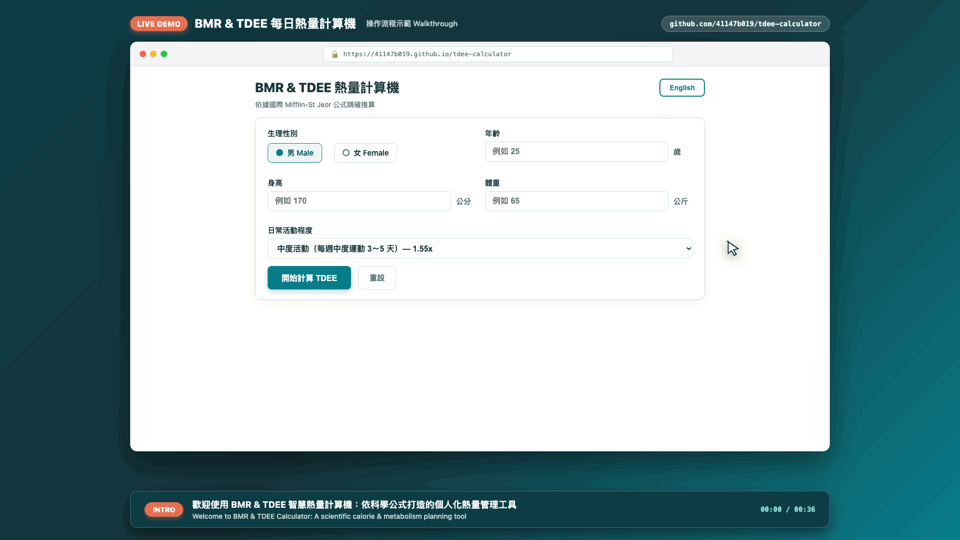

# BMR & TDEE Calorie Calculator / 熱量計算機

一個依據國際 **Mifflin-St Jeor 公式** 精確推算的 BMR（基礎代謝率）與 TDEE（每日總能量消耗）熱量計算工具。  
單一 HTML 檔案架構，內嵌 CSS 與 JavaScript，零外部相依性，雙擊或透過 GitHub Pages 即可直接執行。

---

## 🎬 操作流程動態展示 (Live Demo)

以下為計算機實際操作流程的動態預覽：

  

> 📺 **如何觀看 1080p Full HD 高畫質示範影片？**  
> 1. **在 GitHub 上直接在線播放**：點擊 👉 [**進入 GitHub 內建影片播放器 (docs/20261102-tdee-calculator-demo.mp4)**](https://github.com/41147b019/tdee-calculator/blob/main/docs/20261102-tdee-calculator-demo.mp4)，進入頁面後直接點擊中央的 ▶️ 播放鍵即可串流觀賞！  
> 2. **直接下載檔案至電腦播放**：點擊 👉 [**下載 1080p MP4 原始檔 (8.8 MB)**](https://raw.githubusercontent.com/41147b019/tdee-calculator/main/docs/20261102-tdee-calculator-demo.mp4)，可在本機使用 QuickTime、VLC 播放或直接拖入 Keynote/PowerPoint 簡報中。

---

## 📦 專案交付檔案總覽 (Deliverables)

| 交付項目 | 檔案連結 | 說明 |
| :--- | :--- | :--- |
| 🎬 **操作流程示範影片** | [20261102-tdee-calculator-demo.mp4](docs/20261102-tdee-calculator-demo.mp4) | **1080p Full HD MP4 (8.8 MB)**，可在 GitHub 線上直接播放或下載 |
| 🎞️ **操作動態預覽圖** | [20261102-demo-walkthrough.gif](docs/20261102-demo-walkthrough.gif) | 輕量化 GIF 動態圖 (163 KB)，首頁自動循環播放 |
| 📄 **專題完整報告書** | [20261030-project-report-bilingual.pdf](docs/20261030-project-report-bilingual.pdf) | A4 中英雙語對照 PDF，含痛點分析、公式研究、AI 協作與附錄截圖 |
| 🖥️ **專題分享投影片** | [20261030-presentation-slides-bilingual.pdf](docs/20261030-presentation-slides-bilingual.pdf) | 16:9 中英雙語橫向投影片 (共 7 頁)，專為成果分享設計 |
| 📝 **影片分鏡說明文件** | [20261102-demo-video-guide.md](docs/20261102-demo-video-guide.md) | 詳細記錄影片各秒數時間軸、操作重點與規格參數 |

---

## ✨ 功能特色

- 🧮 **科學精確計算**：
  - **BMR（基礎代謝率）**：採用國際公認精準的 Mifflin-St Jeor 公式。
  - **TDEE（每日總熱量消耗）**：結合 5 種日常活動程度加權係數計算。
- 🎯 **五大目標熱量建議**：
  - **維持現況**：平衡每日攝取與消耗。
  - **溫和減脂**：TDEE － 300 kcal，平穩無痛減脂。
  - **積極減脂**：TDEE － 500 kcal（附帶低於 BMR 的代謝健康警示）。
  - **溫和增肌**：TDEE ＋ 300 kcal，配合規律重量訓練。
  - **積極增肌**：TDEE ＋ 500 kcal，提高訓練強度與超額補給。
- 🌐 **中英雙語切換**：繁體中文（台灣用語）與英文（English）即時一鍵切換。
- 🛡️ **純前端與隱私保護**：無任何伺服器或外部網路連線，不儲存使用者任何個資或身高體重數據。
- ♿ **無障礙友善**：支援鍵盤快捷操作（Enter 鍵計算）與螢幕朗讀（`aria-live="polite"`）。

---

## 🚀 使用與部署方式

### 1. 本地執行
下載或 Clone 此儲存庫，在檔案總管中雙擊 `index.html` 即可在任一現代瀏覽器中開啟使用。

### 2. 開啟 GitHub Pages 免費線上使用
1. 進入此 GitHub 儲存庫頁面，點選 **Settings**。
2. 在左側選單選擇 **Pages**。
3. 在 **Build and deployment** 下的 **Branch** 選擇 `main`，資料夾選擇 `/ (root)`，點擊 **Save**。
4. 等候約 1 分鐘，即可獲得專屬線上網址（例如：`https://41147b019.github.io/tdee-calculator/`）。

---

## 📜 免責聲明
本工具計算結果僅供日常生活、飲食控制與規律運動參考，非醫療診斷。若有特殊慢性病、孕期或進食障礙者，請諮詢合格醫師或專業營養師。
